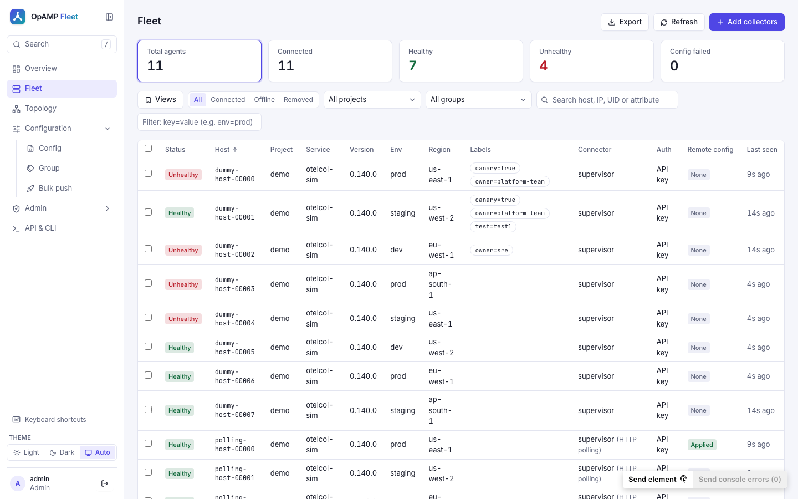
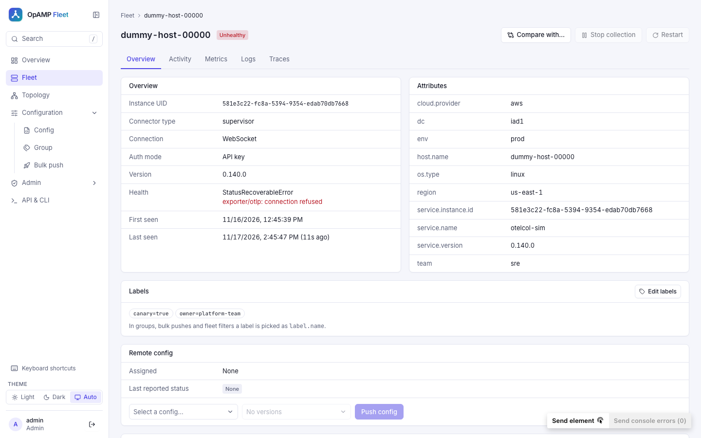
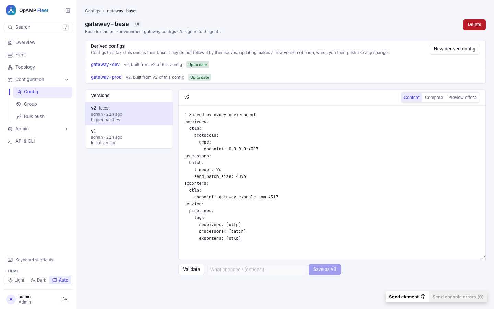
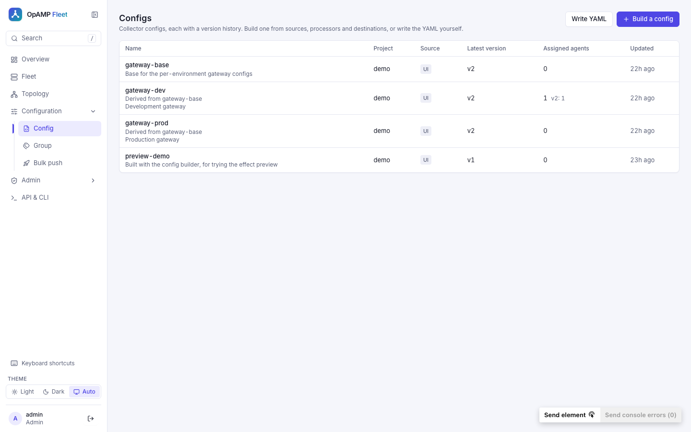
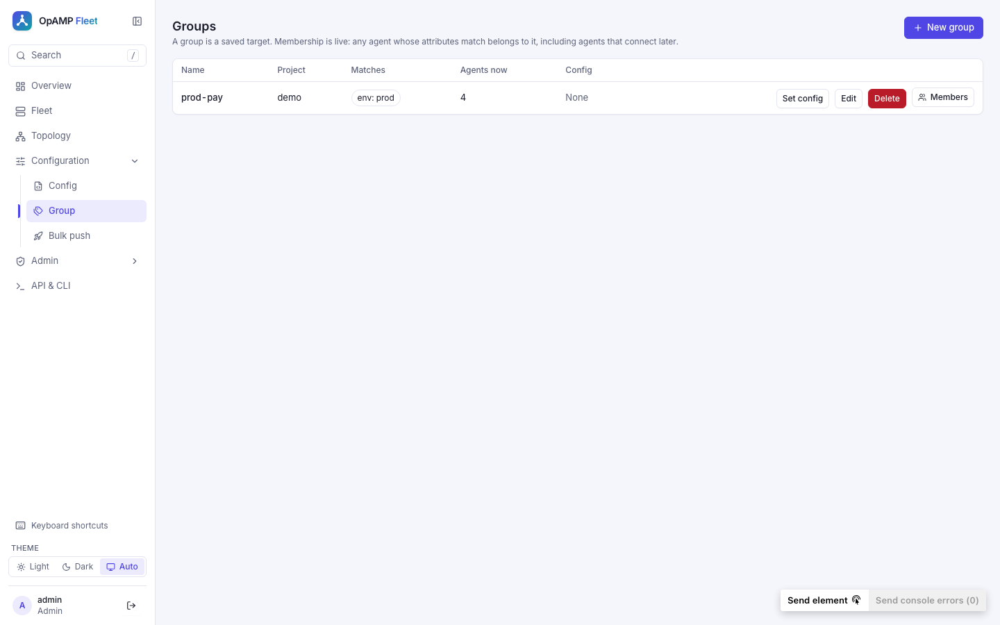
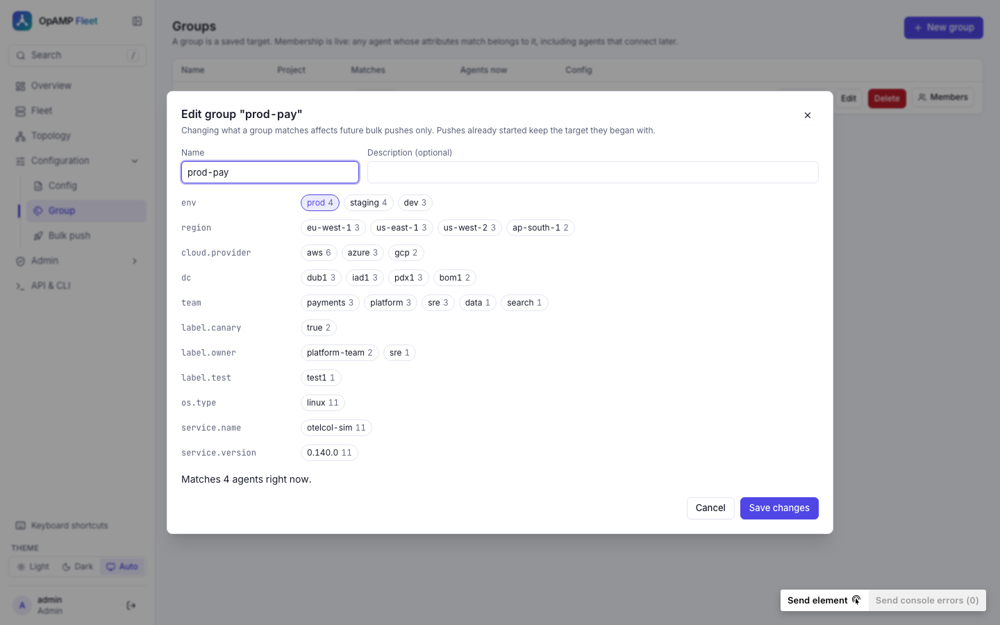
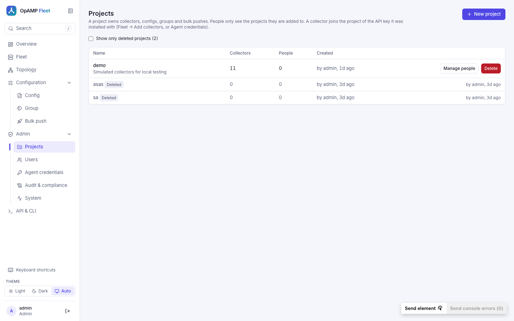
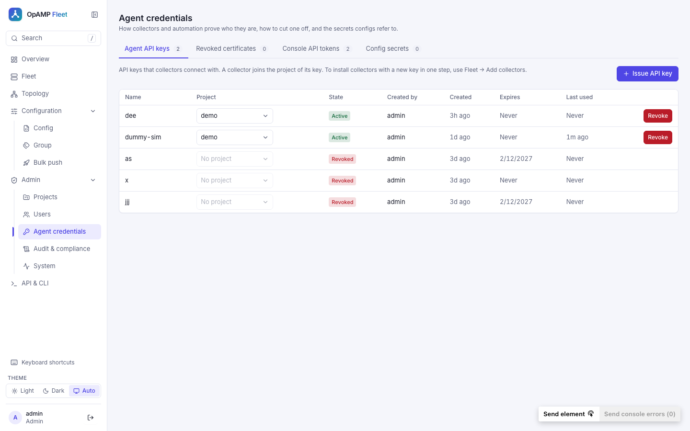

# OpAMP Fleet

**A control plane for managing OpenTelemetry Collector fleets at scale.**

OpAMP Fleet lets platform and SRE teams deploy, configure, monitor and roll out changes to thousands of OTel Collectors from a single console — using the open [OpAMP protocol](https://opentelemetry.io/docs/specs/opamp/).

**Live instance:** [https://130-210-45-41.sslip.io](https://130-210-45-41.sslip.io)
**Demo login:** `admin` / `admin`

---

## Screenshots

**Fleet** — real-time collector inventory with status, attributes, labels and filters

**Agent detail** — per-collector overview, attributes, labels, config assignment and actions

**Config editor** — versioned YAML with derived configs, compare, validate and effect preview

**Configs** — all configs with version history and assignment counts

**Groups** — dynamic agent groups by attribute selector with live membership

**Edit group** — selector editor with live match count

**Projects** — multi-tenant project isolation with member RBAC

**Agent credentials** — API keys, mTLS certs, console tokens and config secrets

---

## Features

### Fleet overview
Real-time dashboard with KPI cards — total collectors, connected, healthy, unhealthy, config failures and offline counts — each with 24-hour trend sparklines. Cards are customisable per user.

### Collector management
Searchable fleet table with attribute filters, group and project scoping. Multi-select bulk actions: restart, stop, resume, remove and side-by-side compare. Views for All, Connected, Offline and Removed collectors.

### Configuration
Versioned YAML editor with full diff/compare, a visual pipeline builder, derived configs (inheritance with overrides), effect preview that models processor behaviour on sample telemetry, and secret references (`${secret:NAME}`) resolved only at push time.

### Groups
Dynamic agent groups defined by attribute selectors with live membership counts. Each group can own a config that is automatically assigned to matching collectors.

### Staged rollouts
Bulk pushes with fixed-batch or canary-percentage strategies, configurable failure thresholds, auto-rollback, manual approval gates, and live progress tracking with pause/abort/rollback.

### Multi-tenancy
Project-based isolation — collectors, configs, groups and credentials are scoped to projects. Per-project and per-group RBAC with additive group-level roles.

### Authentication
Okta SSO (OIDC with PKCE) with role mapping from group claims, plus local username/password as a fallback. Console API tokens with per-token rate limits for CLI and automation.

### Kubernetes support
OpAMP Bridge integration for managing OpenTelemetryCollector CRDs running in Kubernetes clusters, with per-collector config assignment.

### CLI — opampctl
Command-line tool for GitOps workflows. `apply -f` for idempotent config and group management; `push --wait` for scripted rollouts. Downloadable from the console.

### Audit and compliance
Hash-chained, tamper-evident audit log with integrity verification. Scheduled compliance reports (daily/weekly/monthly) downloadable as HTML, CSV or JSON.

### Observability
Per-collector CPU, memory and heap charts; throughput rates from receiver/exporter counters; logs and traces reported by the collector itself. Topology view for grouping the fleet by any attribute dimension.

### System administration
Runtime switches for SSO, local login, mTLS, rate limits, rebalancing and fleet-health alerts — all togglable from the console without redeployment. Live replica status and alert history.

---

## Architecture

| Component | Stack |
|-----------|-------|
| Backend | Go, opamp-go, PostgreSQL, Redis |
| Frontend | React 19, TypeScript, Vite, Tailwind CSS |
| Protocol | OpAMP (WebSocket + HTTP polling) |
| Auth | Okta OIDC, local login, mTLS, API keys |
| Deployment | Docker, Helm, cert-manager PKI |

Horizontally scalable — multiple backend replicas coordinate through Redis for connection routing, pub/sub and distributed state.

---

## Getting started

1. Open [https://130-210-45-41.sslip.io](https://130-210-45-41.sslip.io)
2. Sign in with `admin` / `admin`
3. Create a project, issue an API key, and connect your first collector

The **Install collector** page in the console generates a ready-to-run install script for your platform.

---

## Status

This project is under active development. The source code is private.

---

Built by [Mohammed Saif](https://github.com/msaif95) 
